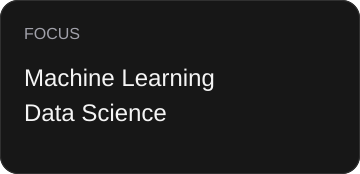
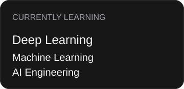
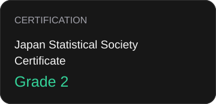
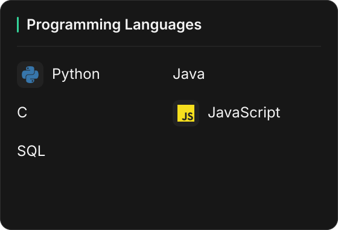
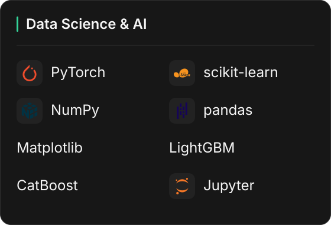
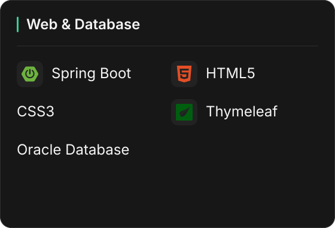
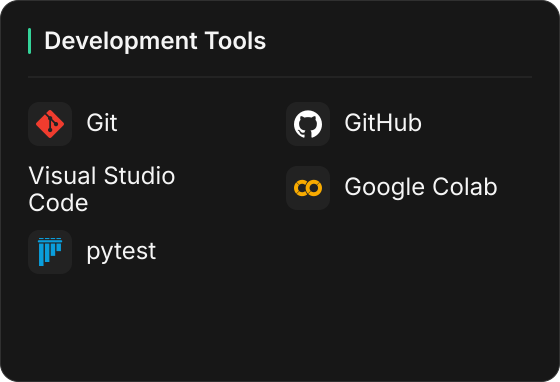
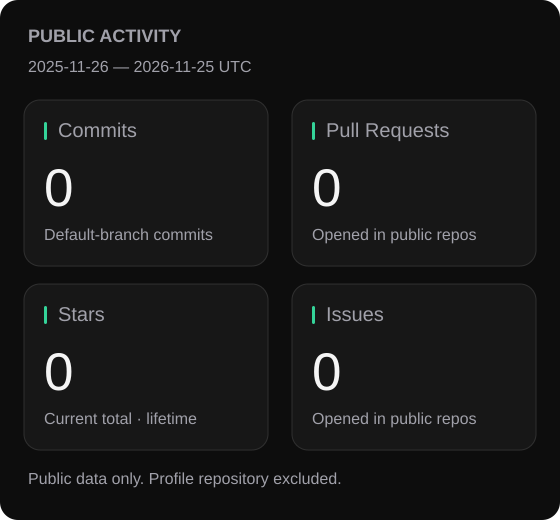
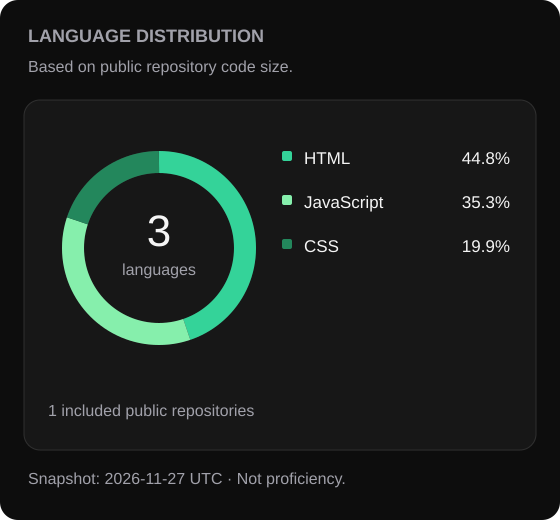

<!-- Generated by scripts/generate_readme.py from config/profile.json. -->
<picture>
  <source media="(prefers-reduced-motion: reduce) and (max-width: 600px)" srcset="./assets/header/header-mobile-static.svg" />
  <source media="(prefers-reduced-motion: reduce)" srcset="./assets/header/header-static.svg" />
  <source media="(max-width: 600px)" srcset="./assets/header/header-mobile.svg" />
  
</picture>

Static header

## 01 / ABOUT ME

I'm a third-year undergraduate student studying Information and Data Science at Chiba University, Japan.

My interests span machine learning, artificial intelligence, data science, software engineering, and data engineering. Through internships and personal learning, I explore practical ways to work with data and build software.

  
  
  

## 02 / TECH STACK

  
  
  
  

## 03 / EXPERIENCE

### Software Engineering Intern

*Jul 2025 – Jul 2026*

- SaaS application development using Java and Spring Boot
- SQL and database development
- Report generation and process improvement

### Data Science Intern

*Sep 2026*

- Document processing and product matching
- Data preprocessing and prototype development

## 05 / GITHUB ANALYTICS

  <picture><source media="(max-width: 600px)" srcset="https://raw.githubusercontent.com/a5my0u/a5my0u/profile-assets/assets/generated/github-stats-mobile.svg" /></picture>
  <picture><source media="(max-width: 600px)" srcset="https://raw.githubusercontent.com/a5my0u/a5my0u/profile-assets/assets/generated/languages-mobile.svg" /></picture>

Scope and metric definitions

- **Activity window:** the inclusive 365-day UTC interval printed on the cards.
- **Commits:** unique commits authored by this account on default branches of owned public repositories. Forks, archived repositories and this profile repository are excluded. Dates use Git committer timestamps (UTC).
- **Pull Requests / Issues:** public items opened by this account in the same interval; the profile repository is excluded. Reviews and comments are not counted.
- **Stars:** the current star total on the included owned public repositories. This is a lifetime stock, not a 365-day activity count.
- **Languages:** GitHub language byte totals from the included repositories. Notebook/code generation can affect shares. This is not a proficiency score.
- **Privacy:** no private repository names, contents, or activity aggregates are used.
- **Updates:** scheduled around 08:00 JST daily. Failed updates preserve the last successful images.

## 06 / CONTRIBUTION ACTIVITY

<picture><source media="(max-width: 600px)" srcset="https://raw.githubusercontent.com/a5my0u/a5my0u/profile-assets/assets/generated/contribution-snake-mobile.svg" /></picture>
